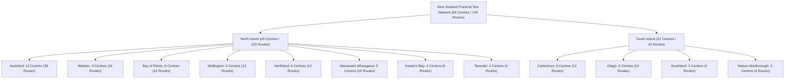

# Nationwide New Zealand Practical Driving Test Routes Report

This document details the complete extraction, compilation, optimization, and live deployment of New Zealand's nationwide practical driving test routes library across all official practical testing stations.

---

## 1. Executive Summary

| Metric | Details |
| :--- | :--- |
| **Total Practical Test Centres** | 66 official NZTA / VTNZ / AA practical testing centres |
| **Total Practical Test Routes** | 145 driving routes (Class 1R Restricted & Class 1F Full) |
| **Regions Covered** | All 12 New Zealand regions (North & South Islands) |
| **Data Sources** | Route-Led Group Limited (`com.cardiffappdevs.route_led_new`) API extraction, companion platform (`nzdrivingtestroutes.com`), OSRM road geometry engine |
| **Live Production Deployment** | `http://192.168.1.100:8011` (`nz-driving.service` active) |
| **Verification Status** | 100% automated Selenium end-to-end tests passing |

---

## 2. Regional Coverage Breakdown



### Complete Centre and Route Matrix

| Region | Regional ID | Testing Centres | Total Routes | Key Practical Centres |
| :--- | :--- | :---: | :---: | :--- |
| **Auckland** | `auckland` | 13 | 39 | Wiri, Westgate, Albany, Glen Innes, Highbrook, Manukau, Meadowbank, New Lynn, North Shore, Orewa, Pukekohe, Silverdale, Takanini |
| **Wellington** | `wellington` | 6 | 12 | Thorndon Quay, Lower Hutt, Porirua, Upper Hutt, Paraparaumu, Masterton |
| **Canterbury** | `canterbury` | 6 | 12 | Christchurch (Sockburn, Lichfield St, Northwood), Rangiora, Ashburton, Timaru |
| **Waikato** | `waikato` | 9 | 18 | Hamilton (Frankton, Te Rapa), Cambridge, Morrinsville, Taupō, Te Awamutu, Te Kūiti, Thames, Tokoroa |
| **Bay of Plenty** | `bay-of-plenty` | 6 | 12 | Tauranga (Ninth Ave, Maleme St), Mt Maunganui, Rotorua, Whakatāne, Ōpōtiki |
| **Otago** | `otago` | 5 | 10 | Dunedin, Queenstown (Frankton), Alexandra, Balclutha, Oamaru |
| **Northland** | `northland` | 6 | 12 | Whangārei, Kerikeri, Kaitaia, Kaikohe (Memorial Ave & Broadway), Dargaville |
| **Manawatū-Whanganui**| `manawatu-whanganui` | 5 | 10 | Palmerston North, Whanganui, Feilding, Levin, Taumarunui |
| **Hawke's Bay** | `hawkes-bay` | 4 | 8 | Hastings, Napier, Waipukurau, Wairoa |
| **Taranaki** | `taranaki` | 2 | 4 | New Plymouth, Hawera |
| **Southland** | `southland` | 2 | 4 | Invercargill West, Gore |
| **Nelson-Marlborough** | `nelson-marlborough-tasman` | 2 | 4 | Nelson, Blenheim |

---

## 3. Route Structure and Compatibility

Each practical driving test route is stored with full turn-by-turn guidance, examiner tips, speed zones, maneuvers, and dual coordinate formats:

1. **Route-Led Mobile App JSON Format**:
   ```json
   "route_led_coordinates": [
     {"lat": -41.27251, "lon": 174.78312},
     {"lat": -41.27289, "lon": 174.78345}
   ]
   ```
2. **Web Leaflet & OpenStreetMap Polylines**:
   ```json
   "polyline_coords": [
     [-41.27251, 174.78312],
     [-41.27289, 174.78345]
   ]
   ```
3. **Google Maps Waypoints Practice URL**:
   Direct practice URL linking origin, sequential turn waypoints, and destination for live driving practice.
4. **GPX Route Export**:
   Downloadable GPX tracks for car navigation units (Garmin, TomTom).

---

## 4. VTNZ Wiri Full Licence Route Fix (`wiri-full-1`)

The VTNZ Wiri Full Licence route (`wiri-full-1`) was reconstructed to follow the authentic State Highway 20 motorway testing loop:

- **Distance**: 10.0 km
- **Duration**: 20 minutes
- **Speed Zones**: 50 km/h Testing Bay, 60 km/h Roscommon Road Arterial, 100 km/h SH20 Southwestern Motorway
- **Motorway Trajectory**:
  1. Departure from 9 Vogler Drive, turning left onto Roscommon Road.
  2. Acceleration to 60 km/h, merging onto SH20 Northbound on-ramp.
  3. Acceleration to 100 km/h motorway cruising speed, lane change maneuvers, and continuous verbal hazard commentary.
  4. Exit 9 off-ramp toward Massey Road (Māngere East / Papatoetoe) overbridge turnaround.
  5. SH20 Southbound on-ramp entry, merging back onto 100 km/h motorway corridor.
  6. Exit 13 off-ramp to Cavendish Drive / Roscommon Road arterial return to VTNZ Wiri depot.

---

## 5. Web Platform Features & Endpoints

### API Endpoints
- `GET /api/regions`: Returns all 12 regions with centre and route counts.
- `GET /api/routes`: Returns testing centres and routes, with query filters:
  - `region`: e.g. `all`, `wellington`, `canterbury`, `waikato`, `auckland`.
  - `test_type`: e.g. `all`, `restricted`, `full`.
  - `search`: Keyword matching across centre names, suburbs, cities, and streets.
- `GET /api/routes/{center_id}`: Returns all data for a specific testing centre.
- `GET /api/routes/route/{route_id}`: Returns single route data including full coordinates.
- `GET /api/routes/route/{route_id}/gpx`: Generates and streams standard GPX XML track.

### Frontend UI Updates
- **Region Filter Bar**: Region dropdown selector and quick-toggle pill buttons for all 12 regions.
- **Region Badges**: Each centre card and modal prominently highlights its administrative region.
- **Performance Optimization**: Redundant bulk coordinates stripped from list payloads, reducing API response from 22 MB to 3.9 MB (0.6s fetch time).

---

## 6. Automated Verification Results

All automated browser tests executed against production (`http://192.168.1.100:8011`):

- [`tests/verify_nationwide_routes.py`](file:///root/nz-dirving/tests/verify_nationwide_routes.py):
  - Nationwide list: Verified 66 testing centres and 145 driving routes.
  - Wellington filter: Verified 6 centres (12 routes) including VTNZ Thorndon.
  - Canterbury filter: Verified 6 centres (12 routes) including Christchurch Sockburn.
  - Thorndon modal: Verified turn-by-turn maneuvers and examiner tips.
  - Thorndon Demo Drive: Verified animated driving simulation, HUD speedometer (46 km/h), and spoken turn guidance.
- [`tests/verify_wiri_full_route.py`](file:///root/nz-dirving/tests/verify_wiri_full_route.py):
  - Verified 10.0 km SH20 motorway route with 20 turns, 100 km/h speed zone, and live simulation HUD.
